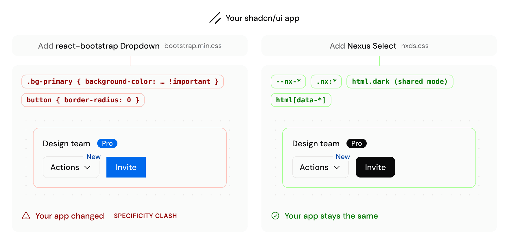
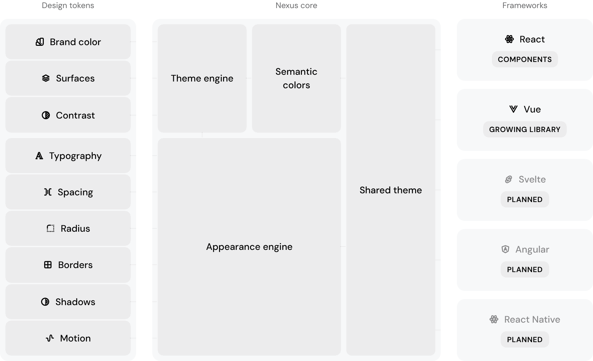

<div align="center">

<a href="https://nxds.dev">
  <picture>
    <source media="(prefers-color-scheme: dark)" srcset="apps/docs/public/brand/nx-icon-dark.svg">
    
  </picture>
</a>

# Your design system starts here.

**nxds** is a theme engine and design system. Set one appearance object, and every component follows your brand, density and corners.

[](https://www.npmjs.com/package/@nxds/core)
[](https://www.npmjs.com/package/nxds-cli)
[](https://github.com/nexuslabs-ai/nxds/actions/workflows/ci.yml)
[](LICENSE)
[](https://discord.gg/PTT5JFyhHw)

[Docs](https://nxds.dev/getting-started/introduction) · [Components](https://nxds.dev/components) · [Playground](https://nxds.dev/playground) · [Storybook](https://storybook.nxds.dev) · [Changelog](https://nxds.dev/changelog)

</div>

<br>

<a href="https://nxds.dev">
  <picture>
    <source media="(prefers-color-scheme: dark)" srcset=".github/assets/readme-hero-dark.png">
    
  </picture>
</a>

## Get started

```bash
npx nxds-cli@latest init
npx nxds-cli@latest add button
```

The CLI copies each component into your app, so the code is yours to edit. For Vue, follow the [install guide](https://nxds.dev/getting-started/install#install-by-hand).

## Customize every detail.

Change one setting. See your system respond.

<picture>
  <source media="(prefers-color-scheme: dark)" srcset=".github/assets/readme-themes-dark.png">
  
</picture>

Every theme passes contrast checks in CI, in light and dark. **[Open Playground →](https://nxds.dev/playground)**

## Your next component shouldn't change the rest.

nxds components bring their own styles, so you add what you need and keep the look you built.

<picture>
  <source media="(prefers-color-scheme: dark)" srcset=".github/assets/readme-coexist-dark.png">
  
</picture>

Works next to MUI, shadcn/ui, Chakra UI, Mantine, Ant Design, Bootstrap and Tailwind. **[Explore integrations →](https://nxds.dev/integrations/overview)**

## One foundation. Many frameworks.

<picture>
  <source media="(prefers-color-scheme: dark)" srcset=".github/assets/readme-frameworks-dark.png">
  
</picture>

**[Explore the engine →](https://nxds.dev/foundations/tokens)**

## Stories are the tests.

The example you explore is the example we check.

<picture>
  <source media="(prefers-color-scheme: dark)" srcset=".github/assets/readme-stories-dark.png">
  
</picture>

**[Open Storybook →](https://storybook.nxds.dev)**

## For designers

Pick a theme in the Playground, then select **Use in Claude Design**. Claude builds your own nxds Design System on a canvas, with live components in your theme.

<picture>
  <source media="(prefers-color-scheme: dark)" srcset=".github/assets/readme-playground-dark.png">
  
</picture>

**[Set up Claude Design →](https://nxds.dev/getting-started/claude-design)**

## For AI agents

Give your agent the nxds skills:

```bash
# Claude Code
/plugin marketplace add nexuslabs-ai/nxds
/plugin install nxds@nxds

# Cursor, Codex, Gemini CLI and other agents
npx skills add nexuslabs-ai/nxds --skill nxds nxds-adopt
```

Every docs page is also Markdown, listed in [llms.txt](https://nxds.dev/llms.txt). **[Read the AI agents guide →](https://nxds.dev/getting-started/ai-agents)**

## Packages

| Package                                         | What it does                                        |
| ----------------------------------------------- | --------------------------------------------------- |
| [`nxds-cli`](packages/cli)                      | Copies nxds into your app and updates it            |
| [`@nxds/core`](packages/core)                   | The theme engine                                    |
| [`@nxds/eslint-plugin`](packages/eslint-plugin) | Lint rules for nxds conventions                     |
| [`@nxds/claude-design`](packages/claude-design) | nxds as a Claude Design System                      |
| [`plugins/nxds`](plugins/nxds)                  | The nxds skills for Claude Code and other AI agents |

## Community

Ask questions, suggest ideas and share what you built in [GitHub Discussions](https://github.com/nexuslabs-ai/nxds/discussions). Chat on [Discord](https://discord.gg/PTT5JFyhHw). Report bugs in [GitHub issues](https://github.com/nexuslabs-ai/nxds/issues). Follow [@nxdsdev on X](https://x.com/nxdsdev) for news.

## Contributing

Read [CONTRIBUTING.md](CONTRIBUTING.md) to set up the repo and run the tests.

## License

[MIT](LICENSE) © Nexus Labs
