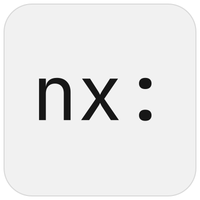
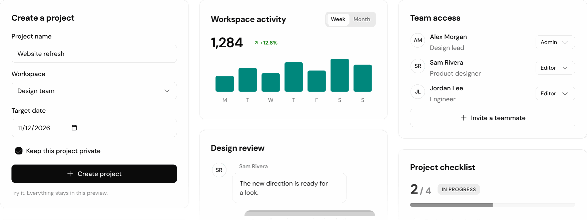
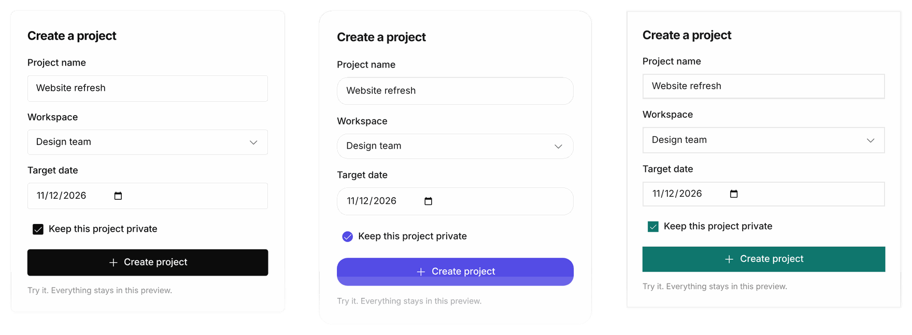
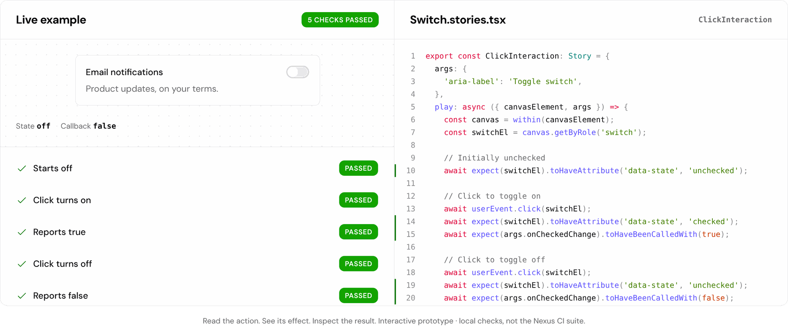
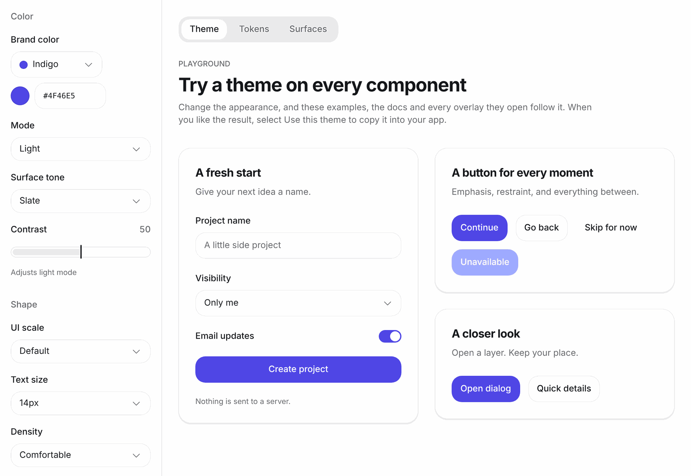

<div align="center">

<a href="https://nxds.dev">
  <picture>
    <source media="(prefers-color-scheme: dark)" srcset="apps/docs/public/brand/nx-icon-dark.svg">
    
  </picture>
</a>

# nxds

Set one appearance object. Every component follows your brand, density and corners.

[](https://www.npmjs.com/package/@nxds/core)
[](https://www.npmjs.com/package/nxds-cli)
[](https://github.com/nexuslabs-ai/nxds/actions/workflows/ci.yml)
[](LICENSE)
[](https://discord.gg/PTT5JFyhHw)

[Docs](https://nxds.dev/getting-started/introduction) · [Components](https://nxds.dev/components) · [Playground](https://nxds.dev/playground) · [Storybook](https://storybook.nxds.dev) · [Changelog](https://nxds.dev/changelog)

</div>

<br>

<a href="https://nxds.dev">
  <picture>
    <source media="(prefers-color-scheme: dark)" srcset=".github/assets/readme-hero-dark.png">
    
  </picture>
</a>

<div align="center">

[Customize](#customize-every-detail) · [Contrast](#contrast-checked-in-ci) · [Coexist](#add-nxds-without-changing-your-app) · [Own the code](#own-every-line) · [Frameworks](#one-foundation-many-frameworks) · [Stories](#stories-are-the-tests) · [Designers](#for-designers) · [AI agents](#for-ai-agents)

</div>

## Get started

```bash
npx nxds-cli@latest init
npx nxds-cli@latest add button
```

`init` sets up a Next.js App Router or Vite app on React 18.3 or 19. For a Vue app, follow [Install by hand](https://nxds.dev/getting-started/install#install-by-hand). [Install](https://nxds.dev/getting-started/install) covers every command and option.

## Customize every detail

One appearance object sets your whole theme. Change one setting, and every component follows.

<picture>
  <source media="(prefers-color-scheme: dark)" srcset=".github/assets/readme-themes-dark.png">
  
</picture>

<p align="center"><sub>One card, three appearance objects. The middle one is the object below.</sub></p>

```ts
// app/appearance-state.ts
export const defaultAppearance = {
  ...nxdsTheme,
  brandColor: '#4f46e5',
  surfaceTone: 'slate',
  corners: 'extra-round',
  density: 'comfortable',
  elevation: 'soft',
} satisfies NxdsAppearanceState;
```

| Setting      | Options                                                                            |
| ------------ | ---------------------------------------------------------------------------------- |
| Brand color  | Any CSS color. The engine derives every hover, pressed, subtle and dark-mode shade |
| Surface tone | Stone, neutral, zinc, slate or gray                                                |
| Contrast     | 0 to 100, set separately for light and dark                                        |
| UI scale     | Small, default, large or larger. Text, icons, spacing and corners scale together   |
| Text size    | 12 to 16 px. Only the text changes, so the layout keeps its spacing                |
| Density      | Tight, compact, default, comfortable, relaxed or spacious                          |
| Corners      | Square, subtle, smooth, round or extra round                                       |
| Elevation    | Flat, quiet, soft, standard or strong shadows                                      |
| Stroke       | Fine, normal or strong borders                                                     |
| Fonts        | UI, heading and code fonts, such as Inter, Geist, Lora and JetBrains Mono          |
| Icons        | Phosphor, Lucide, Tabler, Hugeicons or Remix                                       |
| Mode         | Light, dark or system                                                              |

Every option ships in the stylesheet, so switching needs no rebuild. To change one part of the page, put a data attribute on it:

```tsx
<section data-density="compact" data-radius="round">
  {children}
</section>
```

Try every setting on every component in the [Playground](https://nxds.dev/playground).

## Contrast checked in CI

Pick any brand color, and text stays readable on it. One engine builds every color, hover shade and dark-mode value from your settings, so light and dark can't drift apart.

- **Every pair has a floor.** Each text and background pair has a minimum contrast score. CI fails the build when a pair drops below it.
- **Status colors stay apart.** Error, success, warning and information each get their own tokens. A color-blind audit in CI checks that they stay distinct.
- **Users set their own contrast.** Light and dark mode each have a contrast setting from 0 to 100, and every pair still clears its floor.

[Color](https://nxds.dev/foundations/color) lists the minimum for each pair.

## Add nxds without changing your app

nxds components bring their own styles. Add the one you need, and the rest of your app keeps the look you built.

<picture>
  <source media="(prefers-color-scheme: dark)" srcset=".github/assets/readme-coexist-dark.png">
  
</picture>

nxds CSS defines only `nx:` classes and `--nx-*` variables, and loads as its own CSS entry beside yours. Each library has a setup guide:

[MUI](https://nxds.dev/integrations/mui) · [shadcn/ui](https://nxds.dev/integrations/shadcn) · [Chakra UI](https://nxds.dev/integrations/chakra) · [Mantine](https://nxds.dev/integrations/mantine) · [Ant Design](https://nxds.dev/integrations/ant-design) · [Bootstrap](https://nxds.dev/integrations/bootstrap) · [Tailwind](https://nxds.dev/integrations/tailwind)

Each app in [`examples/`](examples) adopts nxds the way a real team would. [`check.mjs`](examples/scripts/check.mjs) builds an app with and without nxds and lists every host style that changed.

| Example                                     | The team                                              |
| ------------------------------------------- | ----------------------------------------------------- |
| [`nxds-app`](examples/nxds-app)             | Starts a new Next.js app on nxds                      |
| [`shadcn-app`](examples/shadcn-app)         | Has a Next.js app built with shadcn/ui                |
| [`shadcn-package`](examples/shadcn-package) | Has its own shadcn-based design-system package        |
| [`mui-app`](examples/mui-app)               | Has a Vite app built with Material UI and no Tailwind |
| [`react18-app`](examples/react18-app)       | Has a Vite app on React 18.3                          |

## Own every line

The CLI copies each component's source into your app. Edit it like any other file.

| Command  | What it does                                                                         |
| -------- | ------------------------------------------------------------------------------------ |
| `init`   | Sets up Tailwind 4, the token CSS, the appearance provider and your theme            |
| `add`    | Copies a component, the components it uses and the packages it needs                 |
| `diff`   | Lists the files that differ from the latest release                                  |
| `update` | Replaces the files you haven't edited, and merges the release into the ones you have |
| `doctor` | Checks your setup and says how to fix each problem                                   |

If you and a release change the same lines, `update` marks them like a git conflict. On React 18.3, the CLI copies files built for React 18, so you pass `ref` the same way on both versions.

[`@nxds/eslint-plugin`](packages/eslint-plugin) turns the nxds conventions into lint errors, so copied code stays on them after you edit it.

## One foundation, many frameworks

<picture>
  <source media="(prefers-color-scheme: dark)" srcset=".github/assets/readme-frameworks-dark.png">
  
</picture>

[`@nxds/core`](packages/core) is the engine, and it has no framework. Brand color, surfaces and contrast feed the theme engine. Type, spacing, radius, borders, shadows and motion feed the appearance engine. Both write one shared theme that every framework reads.

| Framework                     | Status                                                              |
| ----------------------------- | ------------------------------------------------------------------- |
| React                         | 70+ components on Radix UI, for React 18.3 and 19                   |
| Vue                           | A growing library on Reka UI, held to the React API by parity tests |
| Svelte, Angular, React Native | Planned                                                             |

| Docs section                                | What it has                                                                |
| ------------------------------------------- | -------------------------------------------------------------------------- |
| [Components](https://nxds.dev/components)   | From Button and Input to Combobox, Date picker, Chart, Sidebar and Command |
| [Blocks](https://nxds.dev/blocks)           | Ready-made filters and inline editing, built from the components           |
| [Patterns](https://nxds.dev/patterns)       | How to build forms and filtering with nxds                                 |
| [Foundations](https://nxds.dev/foundations) | Tokens, color, typography, spacing, radius, layering, focus and responsive |
| [Theming](https://nxds.dev/theming)         | The appearance object, and overrides for one element                       |

## Stories are the tests

The example you explore is the example we check.

<picture>
  <source media="(prefers-color-scheme: dark)" srcset=".github/assets/readme-stories-dark.png">
  
</picture>

Every docs example is a Storybook story. Its play function clicks, types and asserts the way a user would. Every story also runs an accessibility check, and CI runs the React stories on both React 19 and React 18.3.

Browse every story in [Storybook](https://storybook.nxds.dev).

## For designers

Design with the components your developers ship, in your theme. nxds exports to [Claude Design](https://nxds.dev/getting-started/claude-design) from one prompt.

<picture>
  <source media="(prefers-color-scheme: dark)" srcset=".github/assets/readme-playground-dark.png">
  
</picture>

1. Set your theme in the [Playground](https://nxds.dev/playground).
2. Select **Use in Claude Design** to copy a setup prompt that carries your theme.
3. Paste the prompt into a new Claude chat that has code execution.

Claude publishes your own copy of nxds as a Design System and installs it on a canvas. It then adds a sampler artboard, a sales dashboard that checks the install, and waits for your design request.

| Your Design System has | What it gives you                                                        |
| ---------------------- | ------------------------------------------------------------------------ |
| Live components        | Every nxds component, with its props in the canvas props panel           |
| Your tokens            | Light and dark tokens in the theme you picked                            |
| Previews and guides    | A preview card and a README for each component                           |
| Icons by name          | Every Phosphor icon, picked by name from a searchable list               |
| Appearance presets     | Density, corners, elevation and stroke for any element, set by attribute |

[Claude Design](https://nxds.dev/getting-started/claude-design) also covers updating to a new release and building every chat in a Claude Project with nxds.

## For AI agents

An agent installs nxds with the CLI, learns its rules from the nxds skills and reads every docs page as Markdown.

| Tool       | What your agent gets                                                                                                       |
| ---------- | -------------------------------------------------------------------------------------------------------------------------- |
| CLI        | No prompts. `--dry-run` shows the files a command would change, and `--json` prints the result                             |
| Skills     | `nxds` covers setup and the `nx:` class rules. `nxds-adopt` adds nxds one component at a time to an app on another library |
| Docs       | [`/llms.txt`](https://nxds.dev/llms.txt) lists every page. Add `.md` to any page URL to get its Markdown                   |
| Lint rules | `@nxds/eslint-plugin` reports code that breaks the nxds conventions                                                        |

In Claude Code, the plugin installs both skills:

```bash
/plugin marketplace add nexuslabs-ai/nxds
/plugin install nxds@nxds
```

In Cursor, Codex, Gemini CLI and other agents that read skills:

```bash
npx skills add nexuslabs-ai/nxds --skill nxds nxds-adopt
```

[AI agents](https://nxds.dev/getting-started/ai-agents) covers the JSON output, exit codes and the full docs file.

## Packages

| Package                                         | What it does                                                     |
| ----------------------------------------------- | ---------------------------------------------------------------- |
| [`nxds-cli`](packages/cli)                      | Copies nxds components and setup into your app, and updates them |
| [`@nxds/core`](packages/core)                   | The theme engine. Turns one appearance object into every token   |
| [`@nxds/eslint-plugin`](packages/eslint-plugin) | ESLint rules that enforce nxds conventions in copied components  |
| [`@nxds/claude-design`](packages/claude-design) | nxds as a Claude Design System, built on every release           |
| [`plugins/nxds`](plugins/nxds)                  | The nxds skills for Claude Code and other AI agents              |

The components live in [`packages/react`](packages/react) and [`packages/vue`](packages/vue). The CLI copies them from there, so they are not installed from npm.

## Community

- [Discord](https://discord.gg/PTT5JFyhHw) for questions and feedback
- [X](https://x.com/nxdsdev) for releases and news
- [GitHub issues](https://github.com/nexuslabs-ai/nxds/issues) for bugs and feature requests

## Contributing

Read [CONTRIBUTING.md](CONTRIBUTING.md) to set up the repo, run Storybook and test your change before you open a pull request.

## License

[MIT](LICENSE) © Nexus Labs
